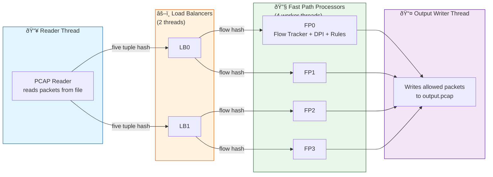

# 📡 Packet Analyzer — Educational Deep Packet Inspection (DPI) Engine

[](https://en.wikipedia.org/wiki/C%2B%2B17)
[](https://cmake.org/)
[](https://github.com/rahuldhiman18/Packet-Analyzer)
[](https://github.com/rahuldhiman18/Packet-Analyzer)

> A beginner-friendly, **zero-dependency** Deep Packet Inspection system written in modern C++17.  
> It reads real network capture files (`.pcap`), inspects traffic at the packet level, identifies applications even inside encrypted HTTPS (via TLS SNI), applies blocking rules, and writes out a filtered capture — all from scratch.

---

## 🎯 What Is This Project? (Simple Explanation)

Imagine the internet as a giant postal system. Every time you visit a website, stream a video, or send a message, your computer ships thousands of tiny envelopes called **packets** across the network.

A **Packet Analyzer** (or DPI engine) is like a smart mail-sorting facility. It:

1. **Opens each envelope** to read the address label (source/destination IP and port).
2. **Peeks inside** to see what kind of letter it is (web traffic, video, chat, etc.).
3. **Recognizes the sender** even if the letter is sealed (for HTTPS, it reads the "SNI" label on the outside of the envelope).
4. **Decides whether to deliver or block** the letter based on rules you set.
5. **Keeps a record** of every conversation so you can see who talked to whom.

This project is a **learning-oriented** version of that facility. It is not a replacement for Wireshark or commercial firewalls — it is designed to teach you how network inspection, flow tracking, and multi-threaded packet processing work under the hood.

---
## ✨ Key Features

| Feature | What It Does |
|---------|--------------|
| 📦 **PCAP File Reader** | Parses standard `.pcap` capture files (Wireshark/tcpdump format) including endianness handling. |
| 🔍 **Layered Packet Parser** | Manually walks Ethernet → IPv4 → TCP/UDP headers to extract ports, flags, and payload. |
| 🌐 **TLS SNI Extraction** | Reads the domain name hidden inside HTTPS `Client Hello` packets (e.g., `youtube.com`). |
| 📊 **Flow Tracking** | Groups packets into conversations using the **Five-Tuple** (source/destination IP, ports, protocol). |
| 🚫 **Rule-Based Blocking** | Block traffic by IP address, application, domain (with wildcards), or port. |
| ⚡ **Multi-Threaded Pipeline** | Reader → Load Balancers → Fast Path Workers → Writer (producer–consumer pattern). |
| 📈 **Statistics & Reports** | Live counters, application breakdown, blocked/forwarded totals, and connection reports. |
| 🧹 **Zero Dependencies** | Pure C++17 Standard Library — no Boost, no libpcap, no Wireshark SDK. |

---

## 🏗️ Architecture

### High-Level Data Flow

```text
┌─────────────┐      ┌──────────────┐      ┌─────────────────┐      ┌──────────────┐
│   INPUT     │      │  PCAP READER │      │  PACKET PARSER  │      │   SNI EXT.   │
│  (.pcap)    │─────▶│  (L2→L4)     │─────▶│  (Ethernet/IP/  │─────▶│  (HTTPS      │
│             │      │              │      │   TCP/UDP)      │      │   domain)    │
└─────────────┘      └──────────────┘      └─────────────────┘      └──────┬───────┘
                                                                           │
                                                                           â–¼
┌─────────────────────────────────────────────────────────────────────────────────┐
│                         RULE ENGINE (Block by IP / App / Domain / Port)         │
└─────────────────────────────────────────────────────────────────────────────────┘
                                                                           │
                                                                           â–¼
┌─────────────┐      ┌──────────────┐      ┌─────────────────┐      ┌──────────────┐
│   OUTPUT    │◀─────│  CONNECTION  │◀─────│   FLOW TRACKER  │◀─────│   RESULT     │
│  (.pcap)    │      │   WRITER     │      │   (Five-Tuple)  │      │   (Allow/    │
│             │      │              │      │                 │      │   Block)     │
└─────────────┘      └──────────────┘      └─────────────────┘      └──────────────┘
```

### Multi-Threaded Pipeline (Full DPI Engine)

The production-grade path uses a **producer–consumer** design so packets are processed in parallel without corrupting shared state:



**Why this design?**
- **Consistent hashing:** Packets from the same conversation always land on the same worker thread. That means each thread tracks its own flows independently — no locks needed on the hot path.
- **Thread-safe queues:** Bounded queues with condition variables move packets between stages safely.
- **Lock-free stats:** Counters use `std::atomic` so reporting never blocks packet processing.

---
## 🔬 How It Works (Step by Step)

### Step 1 — Read the Capture File
The program opens a `.pcap` file (the standard format used by Wireshark). It reads the **global header** (magic number, version, link type) and then streams each packet one by one.

### Step 2 — Parse Network Layers
Every packet is peeled like an onion:

```
┌─────────────────────────────────────────────────────────────┐
│  Ethernet Header (14 bytes)   →  MAC addresses, EtherType   │
│  IPv4 Header (20–60 bytes)    →  Source IP, Dest IP, Proto  │
│  TCP / UDP Header (8–60 bytes)→  Source Port, Dest Port     │
│  Application Payload          →  Actual data (TLS, HTTP…)   │
└─────────────────────────────────────────────────────────────┘
```

### Step 3 — Identify the Application (SNI Extraction)
HTTPS encrypts the contents, but the **Server Name Indication (SNI)** is sent in plaintext during the TLS handshake. The engine parses the TLS `Client Hello` and extracts the domain:

```
Encrypted HTTPS traffic  ──►  Client Hello  ──►  SNI: "www.youtube.com"
```

This is the foundation of nearly all real-world DPI and parental-control systems.

### Step 4 — Track the Flow (Five-Tuple)
Each connection is uniquely identified by:

| Field | Example |
|-------|---------|
| Source IP | `192.168.1.100` |
| Destination IP | `142.250.185.206` |
| Source Port | `54552` |
| Destination Port | `443` |
| Protocol | `TCP` |

All packets sharing these five values belong to the same conversation (flow).

### Step 5 — Apply Blocking Rules
You can block traffic by:
- **IP address** (e.g., block a specific user)
- **Application** (e.g., block YouTube)
- **Domain** (e.g., block `*.facebook.com` with wildcards)
- **Port** (e.g., block port 8080)

### Step 6 — Write the Output
Allowed packets are written to a new `.pcap` file that you can open in Wireshark to verify the results.

---
## 📁 Project Structure

```text
Packet_Analyzer/
├── README.md                    # This file
├── CMakeLists.txt               # CMake build configuration
├── docs/WINDOWS_SETUP.md        # Detailed Windows setup guide
│
├── include/                     # Header files
│   ├── types.h                  # FiveTuple, Connection, AppType, DPIStats
│   ├── platform.h               # Portable endian (big/little) conversion
│   ├── pcap_reader.h            # PCAP file reader
│   ├── packet_parser.h          # Ethernet/IPv4/TCP/UDP parser
│   ├── sni_extractor.h          # TLS SNI / HTTP / DNS / QUIC extraction
│   ├── connection_tracker.h     # Per-flow state machine
│   ├── rule_manager.h           # Blocking rules (IP/App/Domain/Port)
│   ├── fast_path.h              # Multi-threaded worker + manager
│   ├── load_balancer.h          # Load balancer + consistent hashing
│   ├── thread_safe_queue.h      # Thread-safe producer-consumer queue
│   └── dpi_engine.h             # Engine orchestrator
│
├── src/                         # Source files
│   ├── main.cpp                 # Simple single-threaded analyzer (CMake target)
│   ├── main_dpi.cpp             # Full multi-threaded DPI engine entry
│   ├── main_working.cpp         # Simplified working demo
│   ├── main_simple.cpp          # Minimal test version
│   ├── pcap_reader.cpp
│   ├── packet_parser.cpp
│   ├── sni_extractor.cpp
│   ├── types.cpp
│   ├── connection_tracker.cpp
│   ├── rule_manager.cpp
│   ├── fast_path.cpp
│   ├── load_balancer.cpp
│   └── dpi_engine.cpp
│
├── examples/                    # Sample captures & generator
│   ├── test_dpi.pcap            # Sample input capture
│   ├── output.pcap              # Sample output capture
│   └── generate_test_pcap.py    # Python script to generate test captures
│
├── tests/                       # (Reserved for unit tests)
├── build/                       # CMake build output (generated)
└── .git/
```

---
## 🛠️ Requirements

### Software
| Requirement | Minimum | Notes |
|-------------|---------|-------|
| **C++ Compiler** | GCC 9+ / Clang 10+ / MSVC 2019+ | Must support C++17 |
| **Build System** | CMake 3.16+ | Used for the simple analyzer |
| **Python** | 3.6+ | Only needed to generate test `.pcap` files |
| **Git** | 2.0+ | To clone the repository |

### Verified On This Machine
- **OS:** Windows 10/11 (PowerShell)
- **Compiler:** MinGW-w64 `g++` 14.2.0
- **Build:** CMake 3.31.5 + Ninja
- **Python:** 3.12.10

---

## 🚀 How to Run (Windows)

### Option 1 — CMake + MinGW (Recommended, Verified ✅)

This builds the **simple packet analyzer** (`build/packet_analyzer.exe`), which reads a capture and prints a human-readable summary of every packet.

```powershell
# 1. Open PowerShell in the project folder
cd C:\Users\HP\Desktop\Coding\Packet_Analyzer

# 2. Create and configure the build directory
cmake -S . -B build

# 3. Build the project
cmake --build build

# 4. Run the analyzer on the sample capture
.\build\packet_analyzer.exe .\examples\test_dpi.pcap 10
```

**Sample output:**
```
====================================
     Packet Analyzer v1.0
====================================

Opened PCAP file: .\examples\test_dpi.pcap
  Version: 2.4
  Snaplen: 65535 bytes
  Link type: 1 (Ethernet)

========== Packet #1 ==========
Time: 2023-11-15 03:43:20.484823

[Ethernet]
  Source MAC:      00:11:22:33:44:55
  Destination MAC: aa:bb:cc:dd:ee:ff
  EtherType:       0x0800 (IPv4)

[IPv4]
  Source IP:      192.168.1.100
  Destination IP: 142.250.185.206
  Protocol:       TCP
  TTL:            64

[TCP]
  Source Port:      54552
  Destination Port: 443
  Flags:            SYN
...
```

### Option 2 — Full Multi-Threaded DPI Engine (Manual Build)

This builds the **flagship DPI engine** with load balancers, fast-path workers, blocking rules, and reports (`dpi_engine.exe`). This target is compiled directly with g++ because it is not yet registered in `CMakeLists.txt`.

```powershell
cd C:\Users\HP\Desktop\Coding\Packet_Analyzer

# Compile the full multi-threaded engine
g++ -std=c++17 -O2 -I include -o dpi_engine.exe `
    src/main_dpi.cpp src/dpi_engine.cpp src/fast_path.cpp src/load_balancer.cpp `
    src/connection_tracker.cpp src/rule_manager.cpp src/sni_extractor.cpp `
    src/types.cpp src/pcap_reader.cpp src/packet_parser.cpp -lpthread

# Run with blocking rules
.\dpi_engine.exe .\examples\test_dpi.pcap .\examples\output.pcap `
    --block-app YouTube --block-ip 192.168.1.50 --lbs 2 --fps 2
```

**Usage:**
```powershell
.\dpi_engine.exe <input.pcap> <output.pcap> [options]

Options:
  --block-ip <ip>       Block traffic from source IP
  --block-app <app>     Block application (YouTube, Facebook, Netflix, etc.)
  --block-domain <dom>  Block domain (supports *.facebook.com wildcards)
  --rules <file>        Load blocking rules from a text file
  --lbs <n>             Number of load balancer threads (default: 2)
  --fps <n>             Fast-path worker threads per LB (default: 2)
  --verbose             Enable verbose output
```

### Option 3 — Visual Studio 2022 (GUI)

1. Install **Visual Studio 2022 Community** with the **"Desktop development with C++"** workload.
2. Open VS → **"Open a local folder"** → select the `Packet_Analyzer` folder.
3. VS detects `CMakeLists.txt` automatically.
4. Select **Build → Build All**.
5. Run the executable from the generated `build\` folder.

### Option 4 — WSL / Linux

```bash
cmake -S . -B build
cmake --build build
./build/packet_analyzer examples/test_dpi.pcap 10
```

---
## 🎓 Key Concepts for Interviews

If you are presenting this project in an interview, here are the talking points that demonstrate systems-level understanding:

1. **Five-Tuple Flow Identification**  
   `{src_ip, dst_ip, src_port, dst_port, protocol}` uniquely identifies a network conversation — the same concept used by stateful firewalls and NAT.

2. **TLS SNI is the DPI Entry Point**  
   HTTPS encrypts payloads, but the domain name is visible in plaintext during the TLS `Client Hello` handshake. That is how firewalls can block `youtube.com` without decrypting traffic.

3. **Producer–Consumer Pipeline**  
   Reader → Load Balancer → Worker → Writer. Bounded thread-safe queues decouple stages and provide natural backpressure.

4. **Consistent Hashing for Flow Affinity**  
   Hashing the Five-Tuple guarantees all packets of one conversation go to the same worker thread, so connection tracking requires **no mutex on the hot path**.

5. **Low-Level Binary Parsing**  
   Manual extraction of Ethernet/IPv4/TCP headers, handling variable-length headers (IHL, data offset), and converting network byte order (big-endian) to host byte order.

6. **PCAP Format Internals**  
   24-byte global header + 16-byte per-packet header; magic-number endianness detection.

7. **C++17 Concurrency Primitives**  
   `std::thread`, `std::mutex`, `std::condition_variable`, `std::shared_mutex`, `std::atomic`, `std::optional`.

8. **Zero-Dependency Systems Programming**  
   Everything is implemented from scratch using only the C++ Standard Library — no libpcap, no Boost, no Wireshark SDK.

> ⚠️ **Honest note:** This is an *educational simplification*. Production DPI engines (like Suricata, Zeek, or commercial firewalls) also handle TLS 1.3 Encrypted Client Hello (ECH), packet reassembly/defragmentation, kernel bypass (DPDK/AF_XDP), and hardware offloading.

---

## 🔮 Limitations & Future Work

- **TLS 1.3 / ECH:** Encrypted Client Hello hides the SNI; modern DPI requires additional techniques.
- **Packet Reassembly:** TCP segments that span multiple packets are not reassembled before inspection.
- **Live Capture:** Currently reads `.pcap` files only; live interface capture would require libpcap/WinPcap.
- **CMake Target:** The full multi-threaded engine (`main_dpi.cpp`) is compiled manually; it is not yet a registered CMake executable target.

---

## 🤝 Contributing

Contributions are welcome! Please:
1. Fork the repository.
2. Create a feature branch (`git checkout -b feature/your-feature`).
3. Commit your changes (`git commit -m "Add: ..."`).
4. Push to the branch (`git push origin feature/your-feature`).
5. Open a Pull Request.

---

## 📄 License

This project is for educational purposes. See the repository for license details.

---

**Built with ❤️ and pure C++17 — no external libraries required.**

